# ihomy 架构设计

> **定位**:给新成员(及 AI 辅助开发)建立系统全局心智模型——系统由哪些部分组成、一个请求怎么走、为什么关键机制这样设计。规则与约定见 `AGENTS.md`,完整功能需求见 `docs/需求设计说明书.md`,历史踩坑见 `docs/变更归档.md`,本文不重复。
> **数字口径**:92 张表 / 987 个字段 / 57 个 Controller / 86 个 service 类 / 85 个实体 / 86 个 Mapper(24 个自定义 XML) / 411 个接口 / 65 个 DTO / 前端 103 条路由(73 条懒加载) / 176 个页面组件 / 45 个 Api 对象,均为 V11.57 对照代码实测,复核方法见文末附录。

## 1. 系统上下文(C4 Level 1)

ihomy 是家庭内部的内容共享平台,前后端分离:Vue3 PWA 构建产物由 nginx 托管,所有业务请求经 nginx 反代到 Spring Boot;MySQL 持久化,Redis 做缓存/令牌黑名单/未读计数/对战计分,上传文件落本地磁盘由 nginx 静态托管。

出站第三方统一经 `ThirdPartyHttp` 封装(自动 thirdparty 日志 + 脱敏):和风天气(光影与预警)、百度网盘(存储设备映射)、Bing 每日一图(首页每日内容)、SMTP(密码找回邮件,未配置时按未开通处理)、Home Assistant(智能家居实体轮询与控制)、家庭自配的 AI 模型服务(OpenAI 兼容协议,家庭模型池 + 功能绑定)。媒体引擎 Jellyfin 由客户端直连、不经后端出流(见 需求 §4.3.4);语音视频通话的媒体走 WebRTC 点对点,后端只转发信令,必要时经自建 TURN 中继(external.yml 配置,凭证不入 git)。咔哒与比特口袋是两个独立产品页,静态托管在同一个域名下。

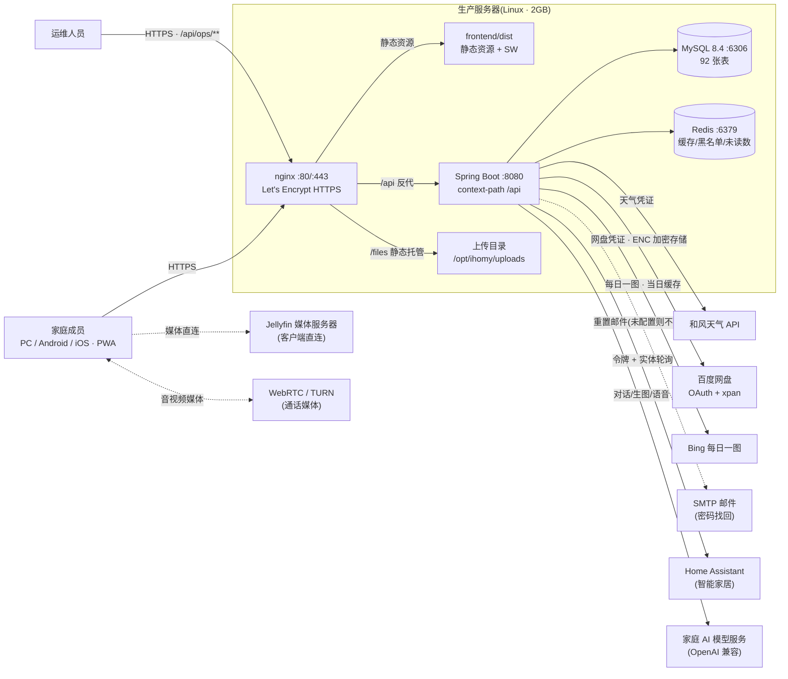

要点:

- **一套代码三端覆盖**:浏览器直接访问,移动端"添加到主屏幕"即 PWA(iOS 要求 HTTPS),不维护原生 App。
- **文件不过后端的手就不走后端**:nginx 直接托管 `/files/`,后端只在"百度网盘中转 / Range 播放 / 签名 URL"场景流式代理(见 §4.5)。
- **家庭是隔离边界**:所有业务表带 `family_id`,跨家庭访问一律 NOT_FOUND(而非 403,不泄露存在性)。OPS 账号不绑家庭,只能进 `/api/ops/**`。
- **重活与实时分开**:业务走 HTTP;聊天、通话信令与对战信令走一条独立 WebSocket;媒体与游戏运行留在浏览器。

## 2. 请求流转

### 2.1 HTTP 主链路

一个业务请求从 nginx 到 MySQL,依次经过两个 Servlet 过滤器(先于 Security 链,`@Order` 决定)和 Spring Security 链内的两个自定义过滤器,再进入三层业务代码:

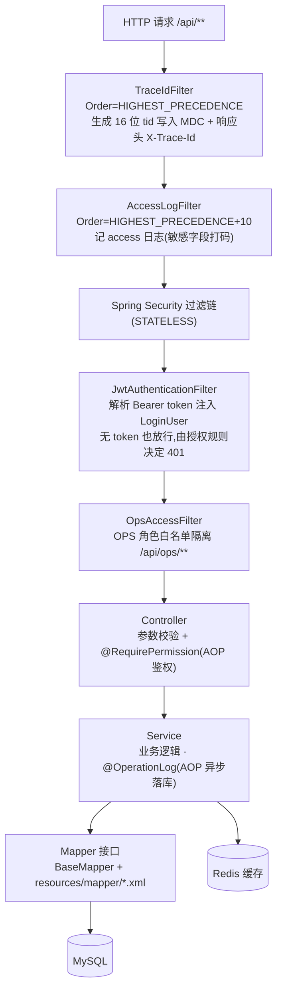

约定背后的设计:

- **tid 在最前**:TraceIdFilter 排在一切之前,保证 access 日志和后续所有日志共享同一 tid,排障时可跨文件串联(见 §4.6)。
- **认证与授权分离**:JwtAuthenticationFilter 只负责"解析出是谁",不拦请求;拦不拦由 SecurityConfig 的 `authorizeHttpRequests` 规则(公开白名单 + `anyRequest().authenticated()`)和 `@RequirePermission` 切面(功能级权限)决定。读类 GET 接口(博客列表/相册/评论等)对匿名开放,写类一律登录。
- **Mapper 不写注解 SQL**:接口仅继承 BaseMapper,自定义 SQL 全放同名 XML,参数统一 `@Param`——SQL 集中可审,避免注解里拼长串。
- **写操作必留痕**:写接口加 `@OperationLog`,与业务同一线程采集、异步落 `sys_operation_log`,运维页可按模块与时间检索。

### 2.2 实时通道(WebSocket)

聊天、通话信令与对战信令共用一条 WebSocket,握手期自行校验 JWT,不经过 HTTP 过滤链:

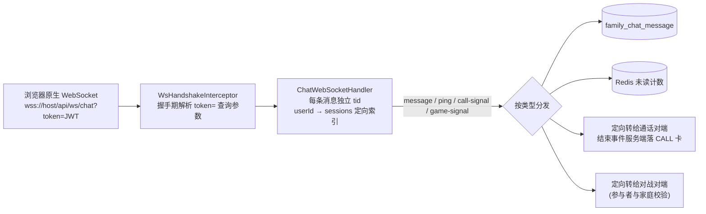

协议为 v2:上行统一 `{type,data}`,下行保留 `ping/pong` 心跳;业务异常用 error envelope 返回而不断连。聊天消息共六类(`TEXT/IMAGE/LINK/CARD/GAME_INVITE/CALL`),payload 为结构化 JSON(≤4KB),发送侧与 WS 侧同一口径校验,渲染一律结构化组件、禁 `v-html`。前端由 `stores/chat.js` 全局单持有连接(指数退避重连 3→60 秒,token 换代重建,登出清场),`/chat` 页与浮窗共用同一个面板组件;HTTP 侧的 `/chat/*` 只负责历史消息、未读与已读游标、链接预览与 ICE 配置。

## 3. 模块分域

后端 57 个 Controller / 86 个 service 类,按业务域分组如下(域划分与 `AGENTS.md` 功能模块清单一致):

| 域 | Controller | 关键 Service | 一句话职责 |
|----|----------------|--------------|-----------|
| 账号 | Auth / Profile | Auth / Captcha / Parameter / PasswordReset | 注册登录、验证码、多家庭切换、个人资料、邮箱自助重置密码 |
| 家庭 | Family / Member | MultiFamily / MemberManagement | 家庭管理、成员角色、邀请码、入家申请、成员分组 |
| 内容 | Blog / Diary / Album / Photo / Cascade / Video / Media / Wish / Library / Music | 各同名 Service;Album、Video、Music 各配 MapService + MapRunner | 博客、日记、相册照片、照片瀑布、放映厅、愿望单、书架、背景音乐 |
| 互动 | Like / Comment / Notification / Chat | ContentLike / Comment / Notification / Chat | 点赞、评论树、通知、聊天室与通话信令、站外链接预览 |
| 生活 | Anniversary / Reminder / Plan / Task / Book / BookAccount / BookBudget / BookRecurring / BookImport / BookPermission / LoanRecord / Finance / Tree / Points / PointsRule / FamilyPlant | 记账套件 + 贷款/理财 + 家谱 + 积分 + 花园 | 纪念日、提醒、计划、任务悬赏、记账本、贷款与理财、家谱、签到积分与兑换、家庭花园 |
| 日程 | Schedule | ScheduleService + 多个 ScheduleSourceProvider | 把纪念日/提醒/计划/子任务与只读来源(贷款还款、理财到期、食材到期)摊平成一份日历与即将到来 |
| 保险箱 | Vault | VaultService | 家庭密码与私密条目,查看需二次验证 |
| 智能家居 | Iot | HomeAssistantService + IotSyncService | 家庭 Home Assistant 配置、实体同步与设备控制 |
| 基础 | File / Storage / Home / Public / Daily / Weather / Announcement / Recycle / Health | File / Storage / SignedUrl / Thumbnail / HomeModule / HomeStats / ActivityFeed / Ops / OperationLog / MapTaskRegistry | 上传、存储设备、首页聚合、公开端点、每日内容、天气、家庭公告、回收站、健康检查 |
| 游戏 | GameInfo / GameMatch | GameInfo / GameMatch | 家庭小游戏库(文件/ROM/网页游戏)与家庭对战 |
| 物品 | Item | Item | 房子/房间/家具/物品五级粒度 + 户型图画布 |
| 厨房 | Recipe | Recipe | 菜单推荐、菜谱、食材 |
| 工具 | MindMap | MindMap | 脑图设计(快照/回滚/多人协同轮询) |
| AI | Ai | AiService + 模型池/功能绑定 | 找物、对话、生图、语音识别,按功能选模型与兜底链 |
| 运维 | Ops / OpsAlert / OssComponent / OpsKadaSnippet | Ops / OperationLog / OssComponent / KadaSnippet | 资源与健康、日志检索、预警、开源组件台账与升级、咔哒卡带审核 |
| 独立产品 | KadaSnippetPublic | KadaSnippet | 咔哒卡带投稿(公开提交、运维审核后落文件与索引) |

前端与后端域一一对应:`api/index.js` 45 个 Api 对象按模块分组,`views/` 176 个页面组件挂 103 条路由(其中 73 条懒加载),Pinia 有六个 store:user(登录态与权限)、app(首页聚合)、theme(主题两轴)、chat(WS 连接与消息)、call(通话状态机)、sync(跨页轻量同步)——**业务状态分散在各页面自行管理,不搞大 store**。

内容/生活/基础三域里的"映射套件"(Album、Video、Music 各配 MapService + MapRunner,共用基础域的 MapTaskRegistry)是存储设备目录映射的异步执行单元:勾选网盘目录后建影子相册/视频/曲目,不拷贝文件,进度可查。

## 4. 关键机制(为什么这样设计)

### 4.1 无状态会话:JWT 双 token + 真 401

access 2h / refresh 7d,普通 refresh **每次使用即轮换并把旧的拉黑**(60 秒宽限返回同一份新令牌,避免多标签互踢),只有连续 7 天不访问才需要重新登录;登出把 refresh token 放进 Redis 黑名单。壁纸氛围屏走独立的 `type=WALLPAPER` 长期令牌,不参与轮换,与浏览器登录互不影响。

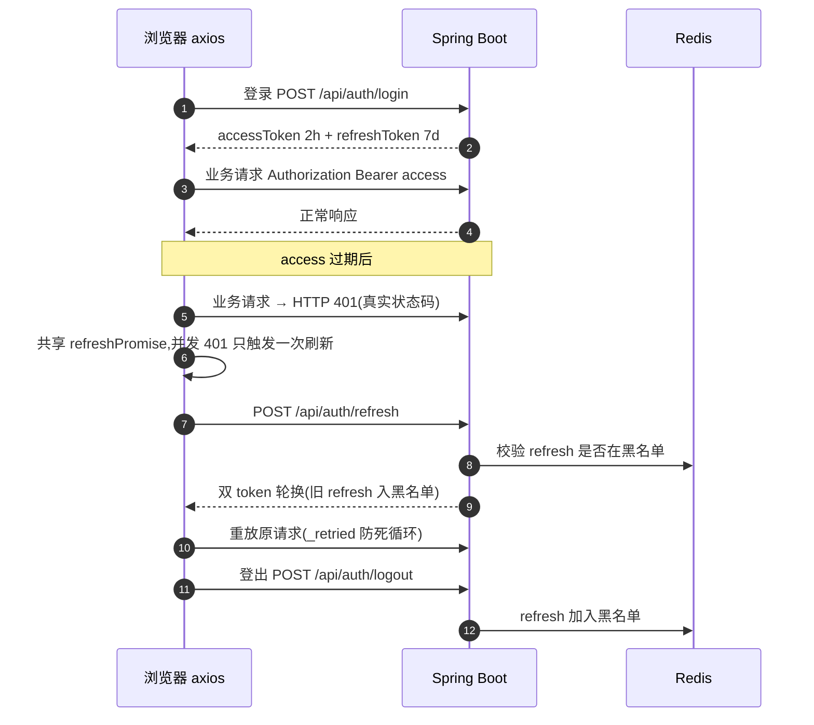

**为什么 entryPoint 必须返回真实 HTTP 401**(2026-09-01 踩坑):前端 axios 只对 HTTP 状态码 401 触发 refresh 流程;如果只在 JSON body 里写 401 而状态码保持 200,续期逻辑永不执行,用户每 2 小时被登出。这是前后端之间最硬的一条契约。另有一条配套规则:`api/request.js` 在发请求前用 `utils/jwt.js` 做**令牌过期预检**,过期且 refresh 有效就先续期——只靠 401 会让 `permitAll` 接口(例如公开首页)永远拿不到登录态。

### 4.2 外挂配置链:生产基线 + 环境覆盖

`application.yml` 是**生产基线**(端口/连接池/路径全部按生产写,敏感项留空),所有环境差异(开发密码、Windows 路径、captcha 固定值、天气与网盘凭证、JWT 密钥、SMTP、TURN、预警通知)统一由 `IHOMY_CONFIG_PATH` 指向的 external.yml 覆盖,不维护 dev profile。

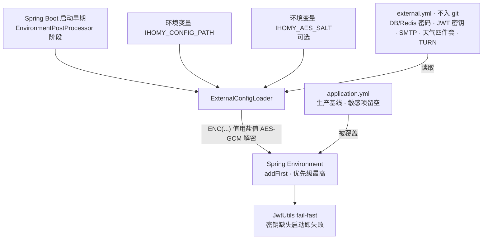

**为什么**:① 敏感凭证与仓库物理隔离(external.yml 进 .gitignore,模板入库),杜绝生产密码入库;② 加载发生在 DataSource/Redis 初始化之前,且注入为最高优先级,保证"基线可被完全覆盖"而非"两边拼接";③ JWT 密钥缺失直接启动失败(fail-fast),避免带空密钥上线。开发环境由 `scripts/setup.ps1` 生成、`start-all.ps1` 注入,新人零手工配置。

### 4.3 权限模型:OWNER 恒真 + auth_code 种子 + OPS 隔离

四级家庭角色 OWNER/MEMBER/CHILD/GUEST + 独立的运维角色 OPS。功能级权限走 `@RequirePermission("code")` 注解 + AOP 切面:

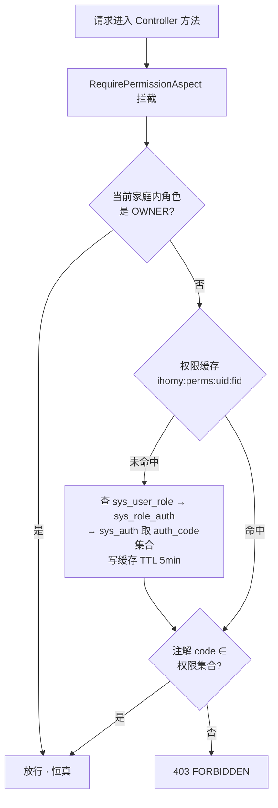

**为什么 OWNER 恒真**:家庭是私有空间,家长天然拥有全部权限,不维护"OWNER 的权限清单"——新增功能时 OWNER 无需配种子即可用。代价是**新增带 `@RequirePermission` 的接口必须把 auth_code 写进 `sys_auth` + `sys_role_auth` 种子**(MEMBER 显式授权),否则 403。注解只写方法上,类级不生效。

**OPS 隔离**(OpsAccessFilter,位于 JWT 过滤器之后):OPS 不属任何家庭,只能访问 `/api/ops/**` + `/api/auth/**`,其余 403;非 OPS 访问 `/api/ops/**` 同样 403。判 OPS 只认 `family_id IS NULL` 的系统级角色绑定,支持复合角色(OWNER+OPS),绑定查询带 5 分钟缓存。这样运维账号即使泄露也摸不到家庭数据。

**多家庭**:同一用户可在多个家庭持不同角色(`sys_user_role.family_id` 区分),JWT 里的 familyId 是切换时刻的快照,refresh 时按 `default_family_id` 优先级重新解析。

**例外:记账本按成员档位**。整本账本用 `family_book_permission`(NONE/READ/WRITE/MANAGE,无行=WRITE)控制,OWNER 恒 MANAGE,只有家长能改档;它不走 `@RequirePermission`,而由 `BookPermissionService.requireRead/requireWrite` 在 Service 层守门,档位不缓存。

### 4.4 首页模块化:插一条记录即扩模块

首页的模块卡片由 `sys_home_module` 表驱动:插入一行(family_id + module_key + enabled + 排序)即出现新模块入口,前端 `stores/app.js` 聚合渲染,**加功能不改前端框架代码**。分组顺序固定为内容 → 生活 → 家庭 → 系统,组内按 `sort_order`;移动端导航另有唯一数据源 `utils/navModules.js`。

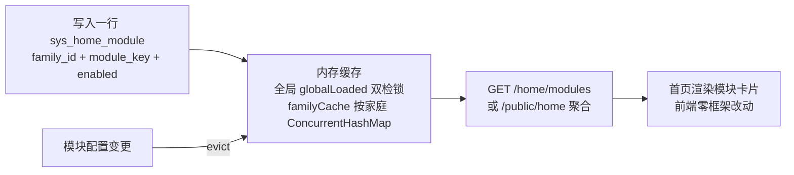

**为什么内存缓存 + 懒加载兜底而不是只靠预热**(2026-09-01 生产事故):`@PostConstruct` 预热阶段 mapper 偶发未就绪,曾导致全局模块永久为空、导航只剩设置/运维。改为预热失败不致命 + 首次查询走 `globalLoaded` 双检锁自动加载。模块配置是典型读多写少数据,Redis 都不必上,进程内 Map + 变更 evict 足够。

### 4.5 文件存储:/files URL 与物理根解耦

DB 只存 `/files/...` 完整 URL,物理位置由 `file.upload-dir` 决定(生产 `/opt/ihomy/uploads`,开发经 external.yml 指向 Windows 路径)——**换存储后端不动业务代码**。

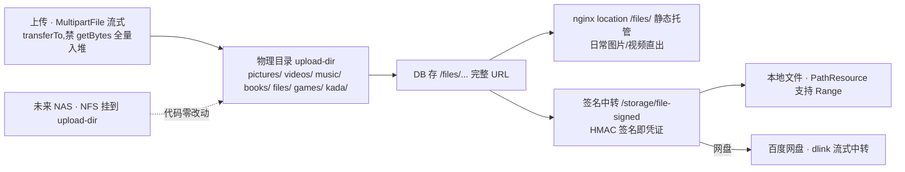

**为什么**:`/files` URL 是稳定契约,物理根是可变实现——未来接 NAS 只需 NFS 挂载到同一目录,代码零改动;需要跨域授权/网盘中转时走签名 URL(HMAC 签名本身即凭证,无需登录态),本地中转用 PathResource 保 Range 播放,网盘用 InputStreamResource 流式拉 dlink。上传必须流式(`-Xmx384m` 的生产 JVM 经不起 200MB 文件入堆)。

`/files/**` 本身也要鉴权:登录态放行;游客按 URL 反查只放 `visibility='PUBLIC'`(清单集中在 `mapper/FileAccessMapper.xml`,**新增带文件 URL 的表必须补一行**);`/files/kada/**` 免登录(咔哒卡带分享);响应带 nosniff 与 CSP。nginx 必须反代到后端鉴权,不得 alias 直出。

删除统一进回收站:照片/相册/视频/图书置 `deleted=1` + `deleted_at`,物理文件保留;`/recycle` 可恢复或彻底删,每日 03:00 清理超过 7 天的项。

### 4.6 日志:三类分流 + tid 贯穿

日志按读者分三个文件,按天滚动保留 7 天;tid(16 位短 UUID)由 TraceIdFilter 最先生成、写入 MDC,贯穿全部三类日志与 `X-Trace-Id` 响应头,`@Async` 线程经 TaskDecorator 自动传递,WS 每条消息独立 tid。

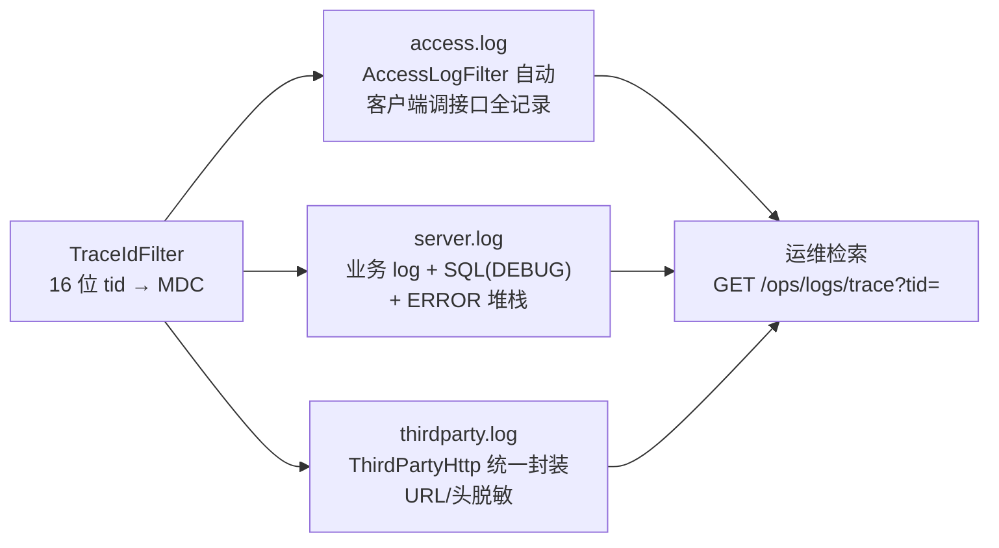

**为什么分三类**:access 面向"谁在什么时候调了什么"(量大、格式固定),server 面向"内部流程与排障"(含 SQL 与堆栈),thirdparty 面向"出站调用审计与配额"(天气、AI、Home Assistant 用量)。混在一个文件里,流量日志会把真正的错误堆栈冲掉。运维页按 tid 跨三类文件检索,前端 5xx 报错 toast 自带 tid,业务人员报障即可直达现场。`LogAlertAppender` 挂在 root + ACCESS + thirdparty,同类异常按窗口聚合预警。

### 4.7 聊天 v2、通话与家庭对战

三者共用一条 WS,但状态各自闭环:

- **聊天**:连接由 `stores/chat.js` 单持有,所有页面共用;消息六类结构化渲染,站内对象卡带快照与跳转,站外链接先做 unfurl 预览(`POST /chat/unfurl`,SSRF 四道防线 + 限流 + 24h 缓存,失败降级纯链接)。浮窗位置键 `ihomy:chat:float:v1` 已登记轻量设置清理清单。
- **通话**:1:1 音视频,`invite/accept/reject/end` 与 offer/answer/ice 全部走 `call-signal` 定向投递,媒体 P2P 直连;结束由服务端单点落 CALL 记录卡(Redis 按 callId 幂等),界面是 `CallOverlay`(全屏视频 + 本地小窗,接听即 user gesture)。ICE 走 `/chat/ice-servers`,STUN 基线开箱即用,TURN 凭证只留 external.yml。
- **对战**:同一张 `family_game_match` 承载两种赛制——`ASYNC_SEED` 同种子赛(2048,双端同 seed 各自打完上报)与 `REALTIME` 实时对战(贪吃蛇,同盘双蛇、共享食物、尸体留场,输入经 `game-signal` 转发,双端确定性模拟)。结算幂等:比分列 NULL=未上报,首报生效;双方都报完才判胜者并只发一次积分(`game_match_win`,同一对手同游戏每日 5 次上限防互刷)。建赛往聊天流发 GAME_INVITE 卡,终局发 CARD(objType=MATCH)结果卡。注意:**建赛入口目前只在 REST 层**,游戏大厅尚无发起按钮,实际从邀请卡进入详情页。

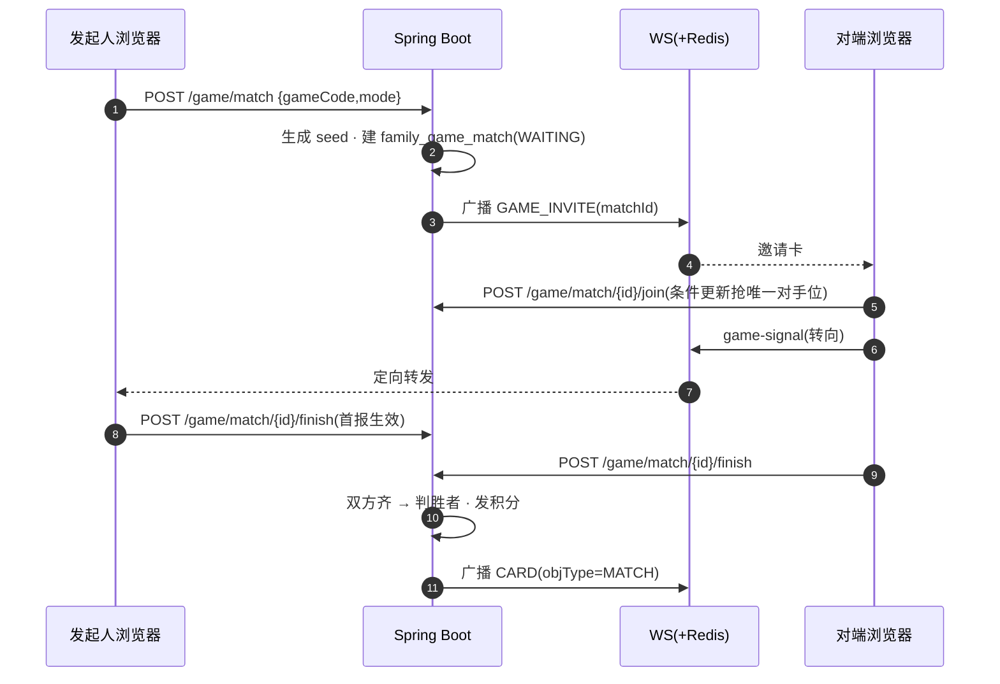

### 4.8 记账口径:余额不落库,前后端同源

记账本不保存账户余额,`balance = 期初 + 收入 − 支出 − 转出 + 转入`,前端 `utils/bookLedger.js` 可复算对账,与后端同一口径。月供金额唯一计算源是 `utils/loan.js`,后端不复算;到期期次由前端按流水口径算出后调 `POST /loan/repay/sync`,后端按 `(loan_id, period)` 唯一幂等补插支出到 `family_book_record`,台账 `family_loan_repay` 保证不重复。调息落在某期还款区间内时,该期按天分段计息,下一期起才按剩余本金与期数重算月供。

周期账目与 CSV 导入都落普通 `family_book_record`:日期推算唯一来源是 `common/BookRecurringSchedule`(短月取月末、2/29 平年取 2/28),`last_generated_date` 条件更新抢占 + 同事务插入保证幂等;CSV 导入先预检再入库,重复行按规则跳过。

### 4.9 日程聚合:只读摊平,写侧各归其位

`GET /schedule/events?from=&to=`(≤62 天)与 `/schedule/upcoming?days=` 把纪念日、提醒、计划、子任务与只读来源摊平成一份清单与日历;写操作仍走各自接口。**贷款还款日、理财到期、食材到期**各是一个 `service/schedule/ScheduleSourceProvider` 实现,新增来源只加实现;事项带 `source`/`readOnly`/`link`,来源开关只在前端 `localStorage`。游客只返回演示家庭的纪念日。提醒的日期推算唯一来源是 `RepeatSchedule.dueToday`(每年可选阳历/农历,闰月严格匹配),循环提醒的按日完成落 `family_reminder_check`,取消即删行。

## 5. 部署拓扑:开发 vs 生产

两端端口完全一致(MySQL 6306 / Redis 6379 / 后端 8080),差异只在"谁托管中间件、谁托管前端":

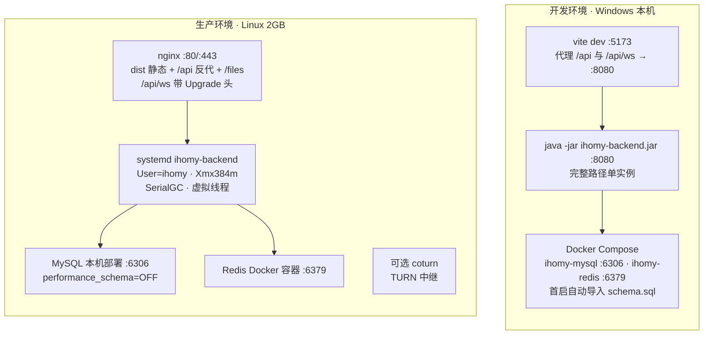

| 差异点 | 开发 | 生产 |
|--------|------|------|
| 中间件 | Docker Compose 一键(MySQL+Redis 都进容器) | MySQL 本机(调优后 ~180MB,不给它常驻 Docker daemon)+ Redis 容器 |
| 前端 | vite dev server,代理 /api | nginx 托管 dist,PWA SW 更新;`/api/ws` 必须反代并透传 Upgrade |
| 后端 | 命令行起 jar,external.yml 指向仓库外路径 | systemd 管理,专用 `ihomy` 用户,`-Xmx384m -XX:MaxMetaspaceSize=192m -XX:+UseSerialGC -Xss512k` |
| 实时 | vite 代理 WS | nginx WebSocket 升级 + 心跳;必要时自建 coturn 供跨网通话 |
| 验证码 | external.yml 固定 `qwer` | 真图形验证码 |
| 配置注入 | start-all.ps1 设 IHOMY_CONFIG_PATH | systemd Environment 指向服务器上的 external.yml(不入 git) |

**为什么 2GB 生产机这样分**:MySQL 调优后本机部署最省内存;Redis 轻量且升级频繁,容器化;后端用虚拟线程(JDK 21)在小堆下也能扛 IO 密集负载。SSH 端口统一 19068(禁 22)。详细步骤在 `docs/部署指导-Linux.md` / `docs/部署指导-Windows.md`(脱敏入库版;生产凭证台账在维护者本地,不入 git)。

## 附录:数字口径与复核方法

2026-11-07 对照代码实测(V11.57;引用本文数字前如隔久建议复核,命令在仓库根目录执行):

| 项 | 数值 | 复核命令 |
|----|------|-------------|
| 数据表 | 92(sys_ 27 / report_ 5 / family_ 38 / content_ 21 / game_ 1) | `grep -c "^CREATE TABLE" backend/src/main/resources/schema.sql` |
| 字段 | 987(全表列数合计,含审计列) | `python scripts/docs-gen/parse_schema.py` 输出 `columns` |
| Controller | 57 | `ls backend/src/main/java/com/ihomy/controller \| grep -c Controller.java$` |
| service 类 | 86(含 `service/schedule` 等子包) | `find backend/src/main/java/com/ihomy/service -name "*.java" \| wc -l` |
| 实体 | 85 | `ls backend/src/main/java/com/ihomy/entity \| wc -l` |
| Mapper | 86 接口 / 24 个自定义 XML | `ls backend/src/main/resources/mapper/*.xml \| wc -l` |
| 接口 | 411 | `cd scripts/docs-gen && python parse_endpoints.py` 输出 `endpoints` |
| DTO | 65(387 个字段) | `ls backend/src/main/java/com/ihomy/dto \| wc -l` |
| 权限码 | 37(auth_code 种子) | `grep -c "INSERT INTO sys_auth" backend/src/main/resources/schema.sql` |
| 路由 / 页面 / Api 对象 | 103 条(73 懒加载)/ 176 / 45 | `grep -c "path: '" frontend/src/router/index.js` 等 |

> **文档漂移已入 CI 闸门**:`bash scripts/doc-drift-check.sh` 校验 VERSION 格式、表数(AGENTS / 需求 §6.2 / 部署指导两版)、实体↔建表、mapper 无 SQL 注解、Controller `@Tag`、权限码种子、模块种子↔前端路由;`gen-code-map.sh --check` 与 `doc-index.sh --check` 校验代码地图与归档索引;CI 每次推送先跑,漂移即失败。

**实体与表**:85 个活跃实体对 92 张表,差额 7 张为无实体的纯关联/字典表——`content_book_category_rel` / `content_visibility` / `sys_auth` / `sys_dict_item` / `sys_role_auth` / `sys_user_group` / `sys_user_group_member`(经自定义 XML 或其他实体访问)。`sys_password_reset_token` 由 `PasswordResetToken` 实体访问、`report_alert` 由 `ReportAlert` 实体访问、`sys_kada_snippet` 由 `KadaSnippet` 实体访问。历史死代码 `entity/FamilyMusic.java` + `mapper/FamilyMusicMapper.java`(映射已重构为 `content_music` 的旧 `family_music` 表)已删除,并由漂移闸门的「实体↔建表」检查防止复发。
