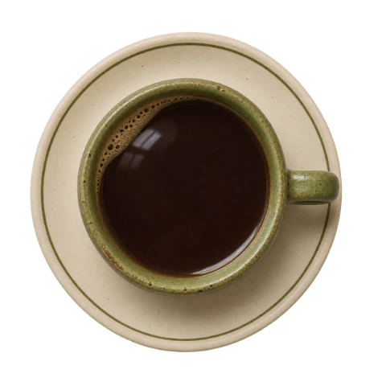
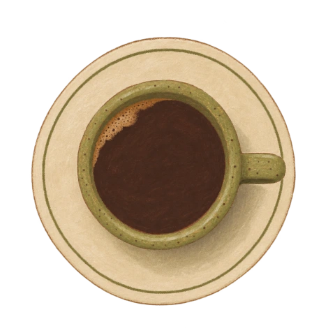
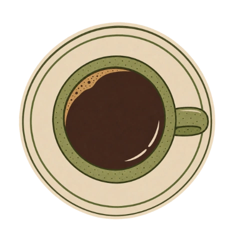

# 窗下桌面 · 物品与出图提示词

> 这份画风研究保留了三种陶杯、物件候选和最初的试摆参数。制作新素材时从水粉杯和文末母提示词起稿，成品的画幅、投影、点击区与避让按[桌沿物件接入规范](../../../../桌沿物件接入规范.md)校对。

从正上方看一张有人用过的桌子。中间是正在看的家庭内容，两边偶尔留下一件生活用品。杯子可以只是刚冲的咖啡，卷了角的纸却可以是真正等了几天的待办。牛油果绿取自暖居已有的叶绿点缀，一组画面里有一处就足够。

## 用同一只杯子选画风

| 写实陶器 | 手绘水粉 | 丝网印刷贴纸 |
|---|---|---|
|  |  |  |
| 咖啡表面映出窗光，杯釉有细小的窑斑。适合强调实物感。 | 杯口有短而断续的笔触，碟子带细粒纸感。适合同时画陶器、纸张、布面和植物。 | 深橄榄轮廓和奶油色裁边，在很窄的桌沿仍一眼可辨。 |

正式桌面采用中间的「旧画册水粉」。新增物品时，用 `cup-gouache.webp` 作为画法、俯视角度和窗光方向的参考，配合下方的统一提示词出图。透明插画在晨色与暮色共用一份，按实际摆放尺寸检查轮廓。三种原始画风保留在同目录的交互样机 `index.html` 中。

单独打开 `index.html` 可以比较三种画风。要在真实站内页面旁试摆，先启动本地 ihomy 前端，再从本目录运行 `python preview.py`，打开 `http://127.0.0.1:4197/__desk/`。前端使用其他端口时可以传 `--site-port`。样机以公开演示家庭读取照片，信封和便签展示示例状态。

## 物品为什么出现，点击后去哪里

| 桌面物品 | 出现条件与变化 | 默认去向 |
|---|---|---|
| 拍立得 | 从访问者可见的最近七个自然日**新上传**照片中抽样。两三张可以轻轻叠着，每张各占一件名额，露出能点的照片边缘。画框用同一套插画，中央填入真实照片。 | 对应相册的照片灯箱。用 `/album/{albumId}?p={shareId(photo.id)}` 直接打开。 |
| 邮戳信封 | 站内通知未读数大于零时才入选。邮票、邮戳和纸色可以换，同一轮只摆一封。纸面默认只展示邮戳，无需显示寄件人或正文。 | 通知中心 `/notification`。目前 ihomy 有站内通知，外部电子邮件需要另接邮箱数据。 |
| 卷边便签 | 绑定一个仍有效的待办。到期当天纸色干净，逾期 1–6 天边角稍卷，7 天以上加深纸缘、增大卷角。便签底色在奶黄、浅豆绿、褪粉里独立抽取。完成或删除后收起。 | 有日期的计划直接到 `/plan?tab=plan&focus={id}`，当天提醒到 `/plan?tab=today`。无日期的计划可按挂起时长做旧，文案称「已放了几天」。 |
| 冒热气的咖啡杯、茶杯 | 上午多见咖啡，午后多见茶，杯口偶尔起两缕淡汽。同一轮饮品只选一种。 | 默认 `/weather`。样机允许把杯子改绑到 `/library`。 |
| 时令水果 | 单颗橘子、青梨或桃子随季节入池。家中实际有这种食材时可优先展示；单纯按季节出现时，提示只说时令。 | 食材清单 `/kitchen/ingredients`。 |
| 布面日记本 | 傍晚比白天更容易出现。露出一根书签带，低饱和布封面和纸口便能交代用途。 | 日记 `/diary`；具备写作权限时可绑定新建日记。 |
| 手机 | 有聊天未读时才入选，屏幕以一枚浅色消息气泡提示。 | 聊天室 `/chat`。手机和信封分别读各自的未读状态。 |
| 季节枝叶 | 春天可是一小簇嫩芽，夏天一片树影色的绿叶，秋天一枚干枫叶，冬天一小段松枝。可结合当月节气筛选。 | 日历当天 `/plan?date=YYYY-MM-DD`。 |
| 压花书签 | 一小段棉线从纸卡伸出，压干的小花可直接沿用季节色。适合摆在只容得下一件细长物品的桌沿。 | 家庭书架 `/library`。 |
| 半露的唱片内袋 | 只露四分之一圈黑胶，让手绘纸套与日记本容易区分。和咖啡一起出现时很像家里刚听完一首歌。 | 音乐 `/music`。 |
| 木夹食谱卡 | 一张有油渍的小纸卡配一枚木夹，午晚饭前入池。菜名可以取自已有可见食谱。 | 家庭厨房 `/kitchen`。 |

数据对接以现有能力为准。照片可从 `appStore.photos` 取 `createdAt`、`albumId`、`id` 和图片地址。通知读 `notificationApi.unreadCount()`，聊天读 `chatStore.totalUnread`，今日计划读 `planApi.today()` 的 `plans[].overdueDays`。切换家庭、账号或访问权限时重新筛选候选，状态失效便释放其名额。读到数据再抽样，用户偏好的点击去向须仍可访问。

## 摆放和动效

- **先量桌沿。** 测量当前主题下正文和侧栏的实际边界，把固定工具、页脚、浮动播放器也算作占用。日程页在 1440px 桌面上的单侧留白，暖居约 150px，光尘约 60px，窗边约 61px。放不下完整杯碟时可以换窄书签或留空。光尘首页的自由布局需再避开现有卡片。
- **视野内共有 0–3 件。** 三张拍立得已经占满三件，猫印出现时按一组计一件。普通时候一两件足够。先抽数量，再从符合条件的物品中抽取种类、左右侧、落点和小角度。纸张大多在正向 ±7° 之内，杯柄固定朝右。物品与阴影完整留在空白，点不到的边角跳过。
- **让摆放有记忆。** 同一次浏览中翻页尽量留在原处。有新内容、开始下一次浏览或点击「换一次摆放」时再抽取。跨页时重新检查碰撞，有遮挡才让位。物品可用键盘获得焦点并打开，悬停或聚焦时说明它通往哪里。
- **猫爪是一件短暂发生的小事。** 三四枚浅印从桌沿错步经过，约四五秒一起淡去。一轮经过后至少隔十分钟才再有机会，回来浏览和切路由都不补播。猫印本身不截获点击。满三件、正在编辑、弹窗、全屏、页面在后台或开启减少动态效果时暂停。手机优先让出触摸区，真实可用边缘足够才考虑出现足迹。

## 新增物品时复用的出图提示词

下面是推荐水粉版的母提示词。每次替换方括号中的内容，并附上本目录水粉杯作为画风参考。

> 为 ihomy「窗下桌面」绘制一件独立的中古家居物品：【物件、用途】。相机垂直向下 90° 正俯拍，像人站在窗边低头看桌面。按【固有方向】正放，完整轮廓居中，四周留出约 12% 透明空间。采用细颗粒哑光水粉插画，大块面先交代轮廓和材质，仅在关键边缘用断续干笔线。物体主色为【材质本色】，辅以奶油白、胡桃褐，牛油果绿只占一小处。光从左上方窗户柔和落下，紧贴物件右下缘只有轻微接触暗部。用【一处生活痕迹】传达被使用过的感觉。主体缩到 80–120px 时仍应清晰可辨。透明 PNG，单物件，物件外透明。排除桌面背景、透视倾斜、厚白边、长投影、悬浮、文字、商标与周边道具。

**填写例**　压花书签，夹在家庭正在读的书里；书签长边竖向、棉绳朝上；原色棉纸和一朵褪紫的小花；圆角处略起毛。拍立得和手机资产留出干净的照片区或屏幕区，由界面叠加真实内容。杯子的蒸汽也留给界面单独绘制，便于深浅适配和减少动态效果。

选写实版时，将媒介一句替换为「中古实物静物摄影，釉面、纸纤维、绒布保留自然微反光」。选贴纸版时替换为「四色丝网印刷，平涂色块、深橄榄细线、贴着轮廓的一圈窄奶油色裁边」。系列固定一种媒介，继续沿用同一机位、光向、配色和比例。
