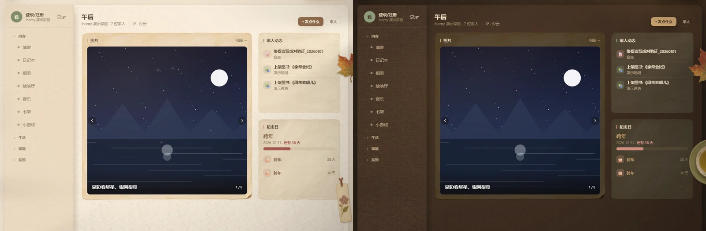

# 暖居 · 窗下翻开的家庭画册

打开暖居，宽屏上先见到一张家里的照片。旁边两张小纸页，一张写今天要记得的事，一张写家人最近发来的消息。窗光落在相纸边上，读完标题，轻点主照片便能翻到下一张，也可以从卡片进入相册。**家庭生活是画册的内容，旧画册水粉是装帧。** 这是首页、业务页面和桌沿物件共同的设计起点。

## 什么值得放在桌面中央

家人拍的照片值得占一块大纸面。提醒需要的面积小一些，但事项和时间要能一眼读完。纪念日与收支接在下面，愿意细看的人可以继续翻。家庭主人可以按自己的习惯安排首页组件；照片在左、两张短列表在右，是第一次打开时的阅读顺序。

手机上，家人新发的一张照片或一篇日记就占一张动态卡。家里有一段刚读过的书，回到「全部」时可以从「上次在…」续读。桌面的书布导航到了手机，收成上下两条窄边，把中间的空间留给一件件内容。

## 材质跟着用途走

书布经常被手碰到，适合做导航。卡纸承托一件可以拿起、移动或翻看的内容，可以看见压痕、刷痕和微翘的纸角。同一页的几张纸共用底色，靠纤维和纸缘见出差别。相册则用一线浅色相纸托住照片，草地、皮肤和夜景都由原片给出颜色。

翻进具体栏目，材质应随阅读密度退到边缘。博客目录和书签可以显纹，读书时纸纹收在工具栏。账本标题可以有纸感，一列金额则需要干净的行底，让小数点、正负号和选中状态清楚。设计新页面时，先把最重要的内容放好，再给承托它的那一层选材质。

## 一天的光，家里的东西

晨色像奶油纸上的胡桃色墨迹。到了暮色，桌面沉成深胡桃色，字和纸缘亮起来。窗棂、树叶与桌沿的杯子共享窗光，杯子投下的影子比一张薄相纸更长。开台灯是单独的动作，即使在同一种纸色下，也能看出灯的明灭。

桌沿物件要经得起点击。拍立得装的是访问者能看的家庭照片，信封对应未读通知，便签对应仍有效的待办。杯子可以只表示一天中的一刻，点它能看天气。桌沿放不下时就留白；没有新照片或待办时，页面也可以平静。[桌沿物件接入规范](../../../桌沿物件接入规范.md)

## 设计时怎么取舍

把草稿缩到手机宽度，或者把窗影关掉，再做一次页面上最常见的动作。家人是否能凭照片找到相册，凭文字找到提醒，凭按钮状态判断操作结果？如果要靠辨认插画或等动效播完才知道怎么用，先改布局、标题或控件。材质合适的尺度，是它能帮助人找到东西，读到内容时又可以忘记它。

页面用色与材质实例见[暖居视觉规范](暖居-视觉解析.md)，外壳、偏好和实现入口见[主题系统设计](主题系统设计.md)。
